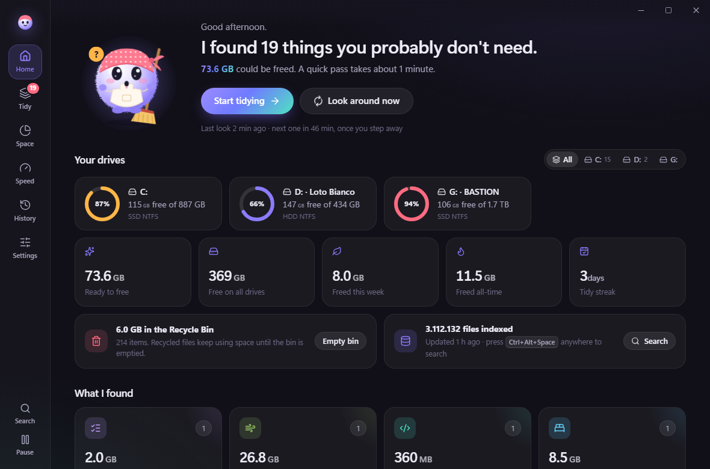
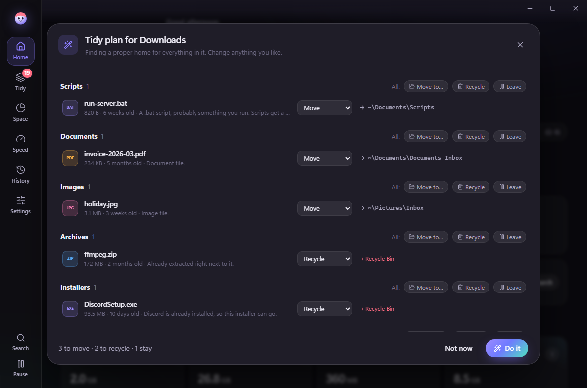
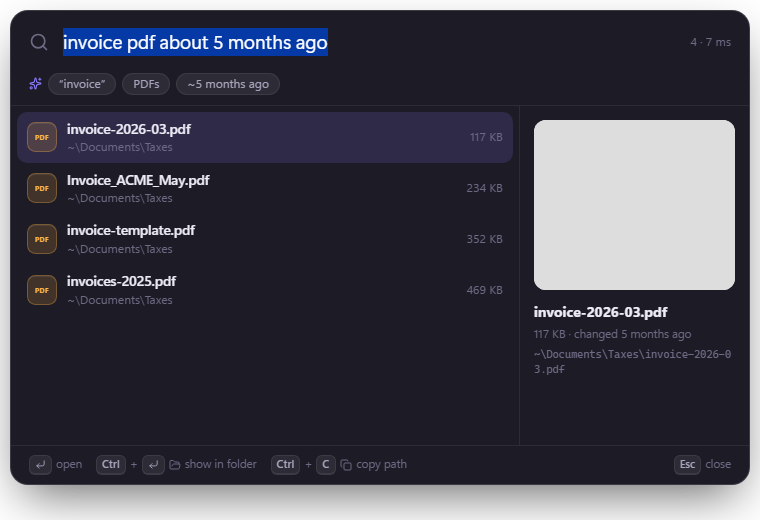
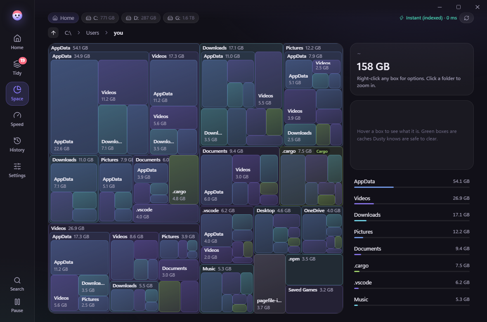
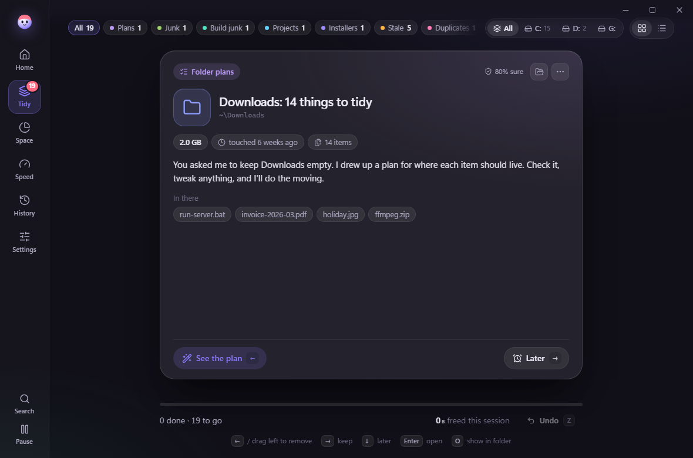
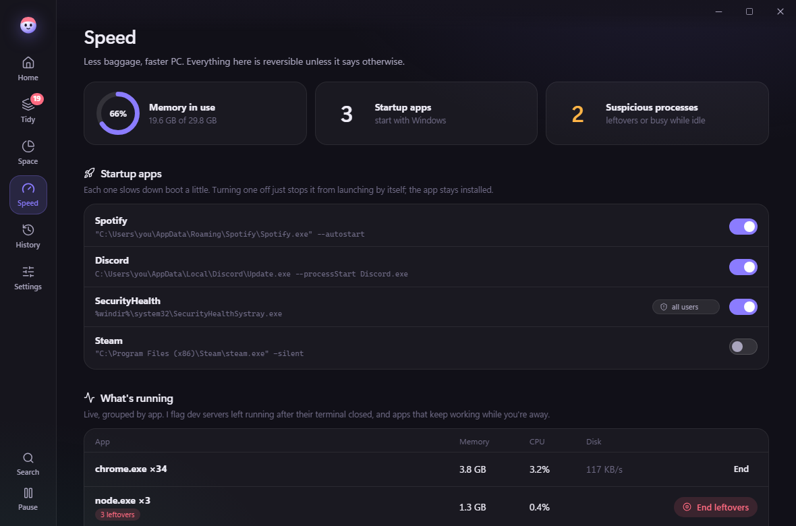
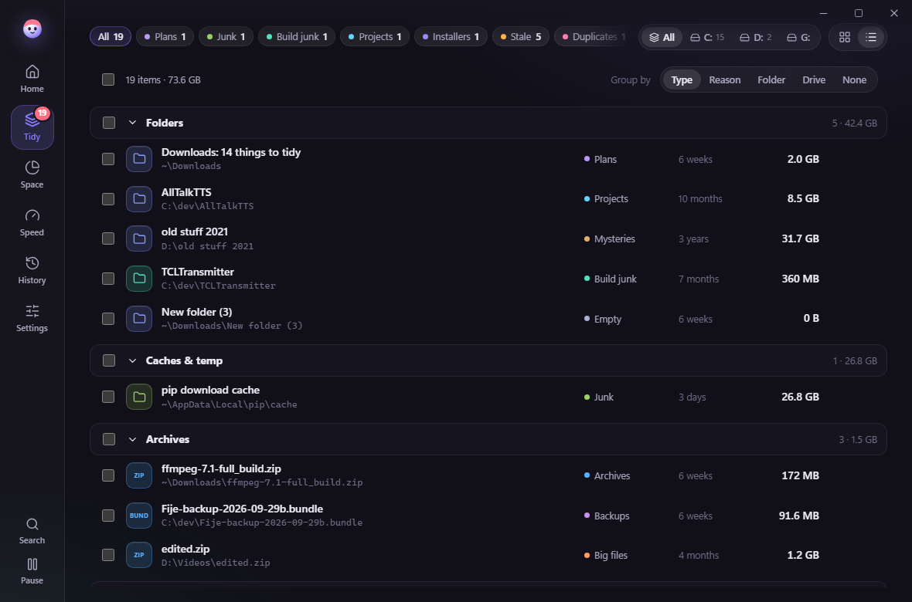
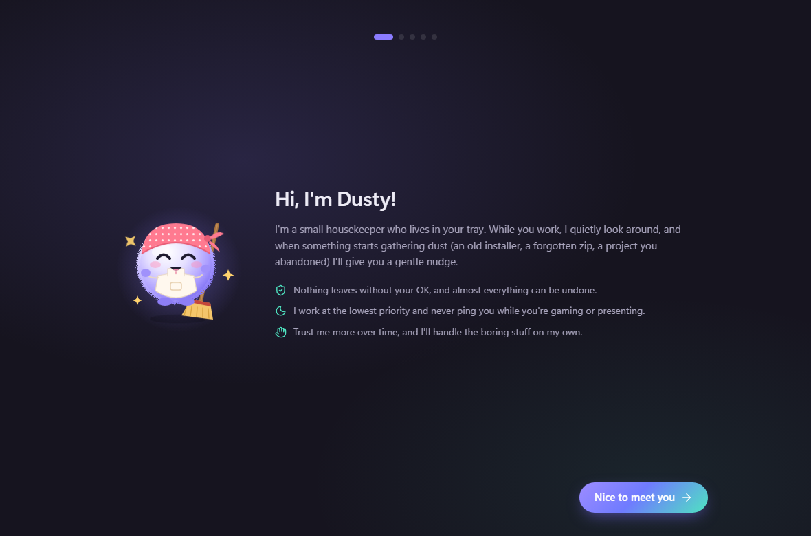

<div align="center">


# Dusty

**A tiny housekeeper that lives in your Windows tray.**
It quietly keeps your files tidy, finds anything you ask for (even by voice) and makes Windows feel
freshly installed again. Specialized, fast and **100% on your computer**: no cloud, no account, no telemetry.




</div>

---

## Why

Every few months the same thing happens: Downloads fills with installers and zips used once, the desktop
turns into a pile, old projects hoard gigabytes of `node_modules`, caches grow silently — and the only
"fix" left is reinstalling Windows.

Dusty makes cleaning **continuous, small and painless**: a couple of one-key decisions now and then,
instead of a reinstall once a year. It's designed for people whose attention is elsewhere —
discreet, never naggy, and blazing fast.

## What Dusty does

### 🧹 Finds what you don't need
| | |
|---|---|
| **Stale downloads** | Things nobody opened or moved in a while, in Downloads and any folder you watch |
| **Old installers** | Setup files for apps it can see are already installed |
| **Extracted archives** | `foo.zip` sitting next to the `foo/` folder it was unpacked into |
| **Duplicates** | Byte-identical copies across your folders *and* data drives (hashes cached) |
| **Near-identical photos** | Resized or re-saved copies, via perceptual hashes of Windows thumbnails |
| **Idle project junk** | `node_modules`, `target`, venvs, conda envs, `.gradle`, build output… |
| **Sleepy projects** | Projects untouched for months → **hibernate**: zipped & verified to cold storage, one click to wake |
| **Temp & caches** | 90+ known locations from a built-in knowledge base (Chrome, Premiere, Gradle, pip, NVIDIA, Steam…) with safety notes |
| **"What's this?"** | Big folders in odd places nobody touched in years — Dusty doesn't know, so it asks |
| **Forgotten backups, empty folders, desktop piles, a bloated Recycle Bin** | |

Every finding explains *why*, *how sure* Dusty is, and where a download came from.

### 🗂️ Keeps folders the way you want
Give a folder a **policy** — *Downloads stays empty*, *keep the Desktop sorted* — and Dusty proposes an
**organizing plan**: every item gets a destination (scripts → `Documents\Scripts`, installers → recycled
if already installed, screenshots → `Pictures\Screenshots`…). Edit anything, then one click.
Dusty learns your corrections.



### ⚡ Makes the PC itself lighter
- **Startup apps** — toggle them exactly like Task Manager does; get told when a new one sneaks in
- **Background hogs** — leftover dev servers and build daemons, apps that burn CPU while you're away
- **Drives** — optimize (defrag HDDs, re-trim SSDs), check fragmentation
- **Tune-ups** — hibernation file, Delivery Optimization cache, component store cleanup, power plans
- **Preinstalled apps** — remove the bloat that came with Windows

### 🔎 Finds anything, instantly
A whole-drive index (millions of files, searched in milliseconds) behind a **global search bar**
(`Ctrl+Alt+Space`, configurable). Ask it like a person:

> *"pdf with invoice from about 5 months ago"* · *"big videos on d:"* · *"setup exe in downloads"*



### 🎙️ Ask out loud
Press `Ctrl+Alt+D` and say *"find the invoice PDF I downloaded about five months ago"*.
Speech is recognised **on your PC** by small open models (Moonshine for English, NVIDIA Parakeet
for 25 languages), in about a third of a second. Dusty shows how it understood you and searches.
It can answer out loud with your local Windows voices (off by default). Voice only *searches*;
it never controls your PC.

### ⌨️ Commands from anywhere
`Ctrl+Alt+K` opens the command palette even when Dusty is in the tray: start tidying, clean the
sure ones, empty the Recycle Bin, pause, jump to any view. Right-click the tray icon for the same.

### 🗺️ Shows where the space went
A SpaceSniffer-style nested map of any drive or folder — instant from the index, with right-click
actions and labels for caches Dusty knows are safe to clear.



## Designed not to bother you

- Scans only when you're idle, at **background CPU + I/O priority**; check intervals stretch out when nothing changes
- Never pings during games, presentations, Focus Assist or quiet hours; at most one nudge every few hours
- **Quick actions** in notifications ("Clean the sure ones") — no need to open the app
- Default action is the **Recycle Bin**; everything goes into a history with **Undo**
- **"Don't touch this"** for a day, a week, a month or forever — files or whole folders
- Per-rule **Autopilot** once you trust it; **learns** from your keep/remove decisions

<table>
<tr>
<td></td>
<td></td>
</tr>
<tr>
<td></td>
<td></td>
</tr>
</table>

## Private by design

- **Everything runs locally:** indexing, detection, speech recognition and search. Nothing about
  your files or your voice leaves the PC. No telemetry, no account.
- **Open source:** you can read exactly what Dusty reads and writes.
- **Signed updates:** Dusty checks for new versions and installs them itself, but only if the
  package carries a valid signature from the project key; anything else is refused.
- **Least privilege:** admin rights are requested only for the specific tune-up that needs them.

## Keyboard

| Where | Keys |
|---|---|
| Anywhere in Windows | `Ctrl+Alt+Space` search · `Ctrl+Alt+K` commands · `Ctrl+Alt+D` voice (all editable in Settings) |
| App | `1`–`6` switch views · `Ctrl+K` command palette · `Z` undo |
| Tidy | `←` remove · `→` keep · `↓` later · `Enter` open · `O` show in folder · `L` list view |
| Search | `Enter` open · `Ctrl+Enter` show in folder · `Ctrl+C` copy path |

## Architecture

```
Rust core (src-tauri)                         Svelte 5 UI (src)
├─ index      whole-drive file index          ├─ Home, Tidy, Space, Speed, History, Settings
├─ nlq        natural-language queries        ├─ search / commands / voice bar (popup)
├─ voice      on-device speech (sherpa-onnx)  ├─ tray menu, desktop buddy (popups)
├─ updater    signed auto-updates             │
├─ detect/*   detectors                       └─ preview mode with a mocked backend
├─ kb.json    app cache knowledge base
├─ organize   classifier + plans
├─ hibernate  verified zip / restore
├─ health/*   startup, processes, tune-ups
├─ learn      decision learning
├─ scheduler  idle-aware, adaptive, background priority
└─ store      SQLite: history, decisions, caches
```

Data lives in `%LOCALAPPDATA%\com.griz.dusty`.

## Build

Requirements: Rust (stable, MSVC), Node 20+, pnpm, WebView2 (ships with Windows 11).

```sh
pnpm install
pnpm tauri dev            # run the app
pnpm dev                  # UI only, in a browser with a mocked backend:
                          #   http://127.0.0.1:1420/?view=triage   (also: home, space, speed, history, rules, /search)
pnpm tauri build          # installer → src-tauri/target/release/bundle/nsis

cd src-tauri
cargo test                                           # unit tests
cargo test --release real_scan  -- --ignored --nocapture   # read-only scan of this PC
cargo test --release real_index -- --ignored --nocapture   # index all drives, time searches
```

The speech engine is linked statically; its bindings need libclang once:
`pip install libclang --target src-tauri/.tools/libclang` (picked up by `src-tauri/.cargo/config.toml`).

### Releases & updates

```powershell
scripts/release.ps1 -Version 0.3.1 -Notes "What changed"
```

Bumps the version, builds a signed installer (key in `~/.tauri/dusty.key`, never committed) and writes
it with `latest.json` to `releases/`. Installed copies check their update source (a folder or an
HTTPS URL, set in Settings › About) every few hours and update themselves when you're away.

**Buy me a coffee link:** set `coffeeUrl` in [`src/lib/config.ts`](src/lib/config.ts) and rebuild.

See [docs/PLAN.md](docs/PLAN.md), [docs/V1.md](docs/V1.md) (road to 1.0), [docs/DESIGN.md](docs/DESIGN.md) (design philosophy), [docs/MASCOT.md](docs/MASCOT.md) (mascot prompts) and [docs/TESTING.md](docs/TESTING.md) for the manual test checklist.

---

<div align="center">Made with ♥ by <b>Griseld Islamaj</b></div>
